# Hexfront

A turn-based hex strategy game for Android and the web browser: you against the computer, with up to 4 mechs, 6 mechs and vehicles in all, and 4 infantry a side, chosen from mechs, tanks, hovertanks, VTOLs, armored cars and infantry.

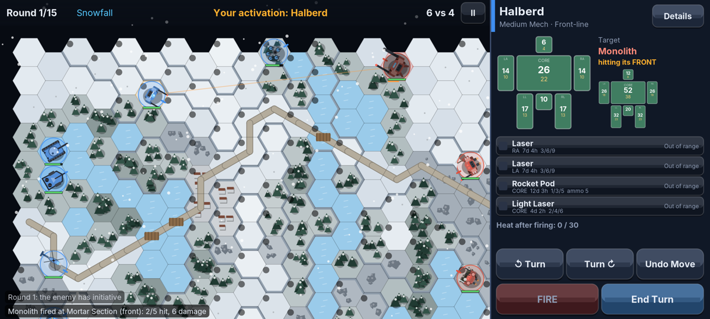

## Install on your phone

1. Copy `release/Hexfront.apk` to your phone (or download it from this repository on the phone).
2. Tap it and allow installs from that app when Android asks. If Play Protect warns about an unknown developer, choose "Install anyway".

Android 5.0 or newer, landscape. No permissions, no network, no ads.

## Play in a browser (Mac, PC, Linux)

`release/Hexfront.html` is the whole game in one file. Download it (on GitHub: open the file, then **Download raw file**) and double-click it; it opens in your browser and runs offline. Chrome, Safari, Edge and Firefox all work.

- **Mouse:** click where you'd tap and drag to pan. Double-click opens a unit's full sheet.
- **Wheel or two-finger trackpad scroll:** zooms the battle map (a trackpad pinch does too) and scrolls long lists.
- **Escape:** works like the phone's back button.
- **Window shape:** the screens are laid out for wide phone screens, so a squarer window (a laptop's 16:10) gets thin bars above and below instead of a squeezed layout.
- **Saves:** kept in that browser's storage, tied to where the file is. Keep the file in one place (moving it, or opening it in another browser, starts with no save). Clearing the browser's website data deletes them.
- **Crash reports:** shown at the next start, as on the phone. **Share report** copies it to the clipboard.

`release/web/` holds the same game as a page plus a script, for putting on any web server (GitHub Pages, for example).

## How it plays

- **Modes.** *Campaign*: fight for a planet as the attacker or the defender (see below); money, units, damage and spare parts carry over, and the game is saved. The enemy is a rival company with its own money and roster: it is paid every contract (more when it wins), repairs what it can afford, loses units left on a field it lost, and buys or upgrades units. Each contract caps the force it can field at a multiple of yours (1.1× Easy, 1.4× Normal, 1.8× Hard); a poor rival fields less. It plays by each scenario's unit limits, buys with the next scenario in mind, and hires stopgap units when it has nothing allowed. *Mercenary*: go planet to planet taking single-battle contracts from the factions fighting there, for pay and standing (see Mercenary play below). *Quick Battle*: spend a budget on a force and fight one battle, against the computer or a friend (see Two players below). Battles in progress are saved as you play: leave the app and **Resume Battle** on the menu puts you back in the same battle.
- **Two players.** *Two Players* in the Quick Battle panel is hotseat play: two people on one phone or computer, passing it between turns. Each player builds a force with the same budget, then each deploys in secret: a hand-over screen hides the map while the device changes hands, and neither sees the other's setup (infantry ambushes included) until the battle starts. If two units end up on one hex, the one away from its home edge sets up nearby. Player 1 is blue on the west edge, Player 2 red on the east; a banner says whose turn it is, either player can concede from the pause menu, and the battle saves and resumes like any other. Afterwards, **Rematch** replays the same two forces, repaired, on a new map.
- **Online.** *Online* in the Quick Battle panel plays a friend on another device: a phone, a tablet or a computer, in any mix (the Android app and the browser page play each other). One player picks **Host a game** and gets a six-letter code; the other picks **Join a game** and types it in. Both build a force with the host's budget at the same time and press **Ready**. The host is Player 1 (blue, west), the guest Player 2 (red, east). The host deploys first while the guest waits, then the guest; neither sees the other's setup. Then you take turns, each on your own screen, and the other player's moves play out on yours with their animations. A dropped connection reconnects by itself and picks up where it left off; while it does, or while the other player is away, a banner says so. Conceding, or leaving from the pause menu, ends the battle for both. Online battles aren't saved, and a saved battle of yours is left alone. Both players need exactly the same version (the build stamp the phone's crash report and the page show): two different builds refuse to pair, and each player is told which version the other has, so the older one can reload the page or update the app. The button only shows in builds that know a relay server (see `server/README.md`).
- **Two-player campaign.** Switch the Campaign panel to *vs Player 2* and Player 2 runs the enemy company: the same fight for a planet, scenario by scenario, with the rival's money, roster, repairs and purchases in a person's hands. Player 1 picks the side to start on. Each turn Player 1 uses their HQ and presses **Done**, a hand-over screen passes the device, and Player 2 uses theirs (seeing the same front and next scenario from the other side) and presses **Fight**. The briefing shows both forces, deployment is secret as in a two-player battle, and afterwards both companies are settled as the player's always is: pay for the result, a destruction bonus and salvage for what they destroyed, wrecks recovered by the side that won or drew and lost by the side that didn't. A player with nothing that may fight (and nothing affordable that may) forfeits the battle to the other. When the planet is decided, both companies move on to the next one and you pick who attacks. The campaign saves whose turn it is; **Continue Two-Player Campaign** picks it up behind the right hand-over screen.
- **Crash and freeze reports.** If the game ever crashes, it saves a report on the way down (the error, the build and phone, what the game was doing, and your last few taps) and shows it the next time you open it, with a **Share report** button to email or paste it. A watchdog does the same if the game freezes for 5 seconds, recording where every thread is stuck.
- **Campaign scenarios.** A campaign is a series of battles that ends when the planet is decided. The front runs from the attacker's dropships (-1) to the defender's base (6) and starts at 2, so the defender has the upper hand. Every battle is one of 21 scenarios, each limiting which units may fight and how many: the **Initial Drop** comes first (VTOLs, hovertanks, wheeled vehicles, light and medium mechs), **Recon Sweeps** are for VTOLs, hovertanks, wheeled vehicles and light mechs (at most 2 mechs and 4 units in all, no infantry), **Pitched Battles** and **Decisive Engagements** take everything, and in between come raids, river crossings, street fights, lance clashes, armored thrusts, air assaults, storms and more. Some lean slightly toward the attacker or the defender (more initiative, a time-out that only asks one side to be close, a free garrison, a bigger force allowance), and the briefing says which. The next scenario is rolled from the last result, the front and a random roll, and is shown at HQ and in the Market *before* you repair, buy and customize. An attacker that reaches the base faces garrison infantry, an armored car, a gun emplacement and a laser turret: win and the planet falls. An attacker driven off its landing zone must hold its dropships or leave the planet. Time is on the defender's side: the attacker lands with 1.5 times the starting funds, but its pay stays flat while the defender's grows with every battle on the planet (up to 2.5 times). Resources become force: the richer side fields reserves beyond a scenario's unit limit (the attacker one extra unit in its first two battles; the defender one from about battle 6, two from 10, three from 16), and the enemy's force limit follows the two sides' resources. When a planet is decided, your company can move on to a new one, on either side.
- **Company colors.** Paint your company from HQ (**Colors**): main, trim and accent from a palette, or a ready-made scheme (Desert, Arctic, Woodland, Night, Crimson, Hazard, Royal), with a live preview beside an enemy unit. On the map the ring under each unit says whose it is (blue yours, red the enemy's), whatever the paint.
- **HQ roster.** Tick units to deploy for the next battle. Tabs show only mechs, vehicles, or VTOLs and infantry (with counts), and **Sort** orders the roster by name, type, value, condition or deployed first. Rows stay readable and a long roster scrolls, as does the selected unit's loadout. In battle, a unit with many weapons keeps full-size weapon rows and the list scrolls.
- **Deployment.** Before the first round you place your units: infantry can go on any open hex on the map, everything else starts in your home zone. The computer digs its infantry into woods and towns too.
- **Details.** Double-tap any unit (on the map, in HQ or in the Market) for its full sheet: every location's armor and structure, every weapon's numbers, and what each piece of equipment does.
- **Hit feedback.** Every hit bursts on the part of the unit it struck. The battle panel switches to the target's hit-location diagram, flashing each struck location with the damage (yellow for armor, red for structure) and a running total. The combat log lists damage by location, e.g. "Monolith fired at Halberd (front): 5/5 hit, 46 damage: 29 to core, 11 to left arm, 2 to right arm, 4 to right leg".
- **Turns.** Each round one side wins initiative, then the sides alternate activating one unit at a time. On an activation: tap your unit (the hexes it can reach glow green inside a bright outline and the rest of the map dims), tap a green hex twice to move, tap an enemy to target it, pick weapons (hit chances shown per weapon), FIRE, rotate if you like, End Turn. Undo takes back a move until you fire. Drag to pan, pinch to zoom.
- **Hit locations.** Every unit has locations with **armor** and **infrastructure**. Damage strips armor, then infrastructure; a location without infrastructure is destroyed with its weapons. Later hits on a destroyed location (and damage left over when one is blown off) carry through to the core at half strength. Which location gets hit depends on the **angle of attack** (front, side or rear arc, relative to the target's facing) plus a random roll. Mechs: cockpit, core, back, arms, legs. Vehicles: front, sides, rear, turret (rotor on VTOLs). Infantry: one platoon.
- **Heat and ammo.** Energy weapons generate heat, ballistic weapons use ammo, missiles do some of both but are light. Each unit sheds a limited amount of heat per round; running hot costs movement and accuracy, and maxing out shuts the unit down. Standing in water cools you.
- **Terrain.** Hills block sight and give high ground, woods give cover and block sight when thick, towns give cover, water cools, roads speed up wheels. Each unit type moves differently: wheels stay on roads and open ground, hovertanks skim any water and weave through light woods, tracked tanks handle light woods, mechs and infantry go almost anywhere, VTOLs fly over everything. Tap an empty hex for its terrain card: the MP each kind of unit pays to enter it (or that it can't), and what it does for cover, line of sight and cooling.
- **Weather.** Rain, thunderstorms, fog, night, heat waves, snow, sandstorms and magnetic storms each change accuracy, sight range, cooling or electronics.
- **Maps.** Generated fresh for every battle in four regions (temperate, desert, arctic, badlands). Elevation comes first, then lakes in the low ground, rivers that flow downhill between the two armies, forests where it is wet, rocks on high ground, a town, and a road with bridges linking both sides.

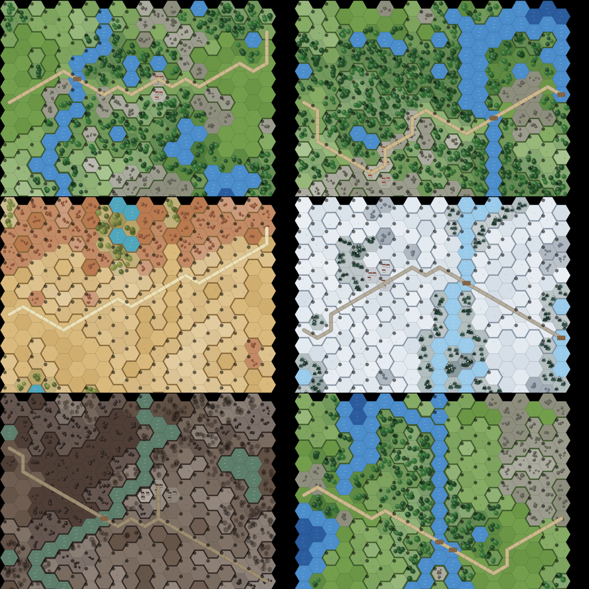

## Units

9 types, 97 designs you can buy (plus 3 fixed emplacements that defend bases), built by eight factions, each with its own artwork, each in a role: Scout, Front-line, Striker, Fire Support, Artillery, Brawler, Command.

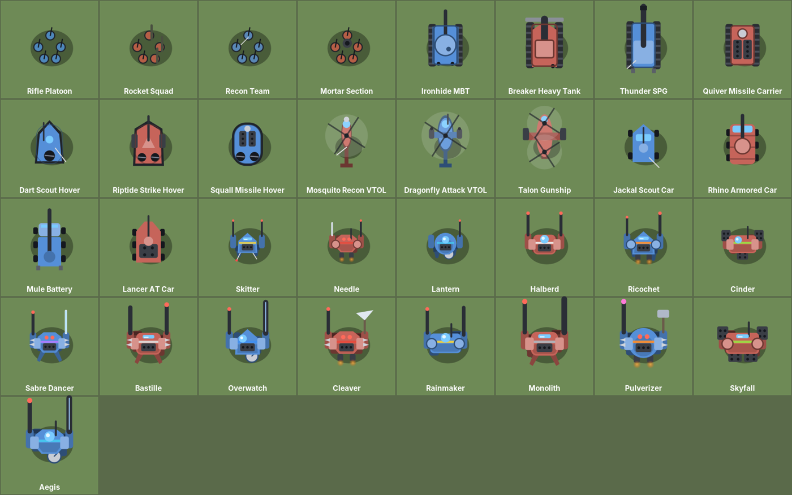

| Type | Designs | Notes |
|---|---|---|
| Infantry | Rifle Platoon, Rocket Squad, Recon Team, Mortar Section, Hegemony Grenadiers, Pike Squad, Sapper Team, Prospector Rifles, Ghost Cell, Accord Rangers, Pact Heavy Weapons | Cheap; hard to hurt with big guns; good in woods and towns. The Mortar Section is a glass cannon: big damage, easy to kill |
| Tracked Tank | Ironhide MBT, Breaker Heavy Tank, Thunder SPG, Quiver Missile Carrier, Lumen, Bulwark, Citadel, Salvo, Longreach, Sentinel, Hedgehog, Anvil, Hammerfall | Most armor of any vehicle; heavy weapons |
| Hovertank | Dart Scout Hover, Riptide Strike Hover, Squall Missile Hover, Glare, Gale, Cyclone, Skein, Phantom, Tern | Very fast; crosses deep water and light woods |
| VTOL | Mosquito Recon VTOL, Dragonfly Attack VTOL, Talon Gunship, Kite, Peregrine, Murk, Skylark, Gunhawk | Flies over terrain; light armor; flak deals double damage to it |
| Wheeled Vehicle | Jackal Scout Car, Rhino Armored Car, Mule Battery, Lancer AT Car, Sparkfly, Relay, Badger, Mongrel, Ox Hauler, Ranger, Aurora, Bison | Fast on roads; armor like a heavy mech |
| Light Mech | Skitter, Needle, Lantern, Sunspear, Swift, Watchman, Wraith, Vanguard | Fast, light weapons only |
| Medium Mech | Halberd, Ricochet, Cinder, Sabre Dancer, Corona, Warden, Harrier, Brushfire, Arbiter, Thorn, Homesteader, Shade, Paladin, Forge | |
| Heavy Mech | Bastille, Overwatch, Cleaver, Rainmaker, Prism, Bastion, Firestorm, Oracle, Briar, Nightfall, Templar, Crucible | Heavy weapons |
| Assault Mech | Monolith, Pulverizer, Skyfall, Aegis, Solar Flare, Juggernaut, Pyre, Bramble, Sovereign, Colossus | Most armor and firepower |
| Emplacement | Gun Emplacement, Missile Bunker, Laser Turret | Campaign bases only; can't be bought or moved |

## Factions

Every design is built by one or more of eight factions. Each faction builds around a specialty and has six designs of its own; the members of each bloc share eight more, and common designs (riflemen, the Ironhide, the Halberd) are built widely. The Market shows who builds each design and can filter by unit kind, faction and role, show only what you can afford or what the next scenario allows, and sort by price, name, speed, firepower, armor or range. The workshop's weapon and equipment lists scroll at full size and can be sorted and filtered by make, spares and fit. In mercenary play factions decide who hires you and who sells to you; the campaign and quick battles don't use factions and sell every design.

| Faction | Bloc | Specialty | Its own designs |
|---|---|---|---|
| Helion Concord | Northern Accord | Energy weapons | Sunspear, Corona, Prism, Solar Flare, Glare, Lumen |
| Vardan Hegemony | Iron Pact | Armor and cannons | Bulwark, Citadel, Warden, Bastion, Juggernaut, Hegemony Grenadiers |
| Kestrel League | Northern Accord | Speed | Swift, Harrier, Gale, Cyclone, Kite, Peregrine |
| Ashfall Collective | Iron Pact | Missiles and artillery | Brushfire, Firestorm, Pyre, Salvo, Longreach, Sparkfly (and the Skyfall) |
| Meridian Syndicate | Northern Accord | Electronics and command | Watchman, Arbiter, Oracle, Relay, Skein, Sentinel (and the Aegis) |
| Thornwall Compact | independent | Close assault and infantry | Thorn, Briar, Bramble, Pike Squad, Sapper Team, Hedgehog |
| Ironroot Freeholds | Iron Pact | Rugged vehicles | Badger, Mongrel, Ox Hauler, Ranger, Homesteader, Prospector Rifles |
| Obsidian Veil | independent | Raiders and stealth | Wraith, Shade, Nightfall, Phantom, Murk, Ghost Cell |

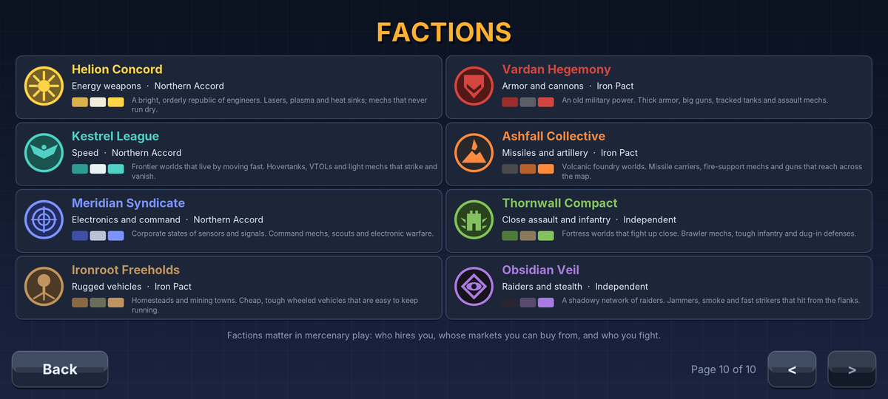

Shared by the Northern Accord: Vanguard, Paladin, Templar, Sovereign, Skylark, Tern, Accord Rangers, Aurora. Shared by the Iron Pact: Anvil, Bison, Hammerfall, Forge, Crucible, Colossus, Pact Heavy Weapons, Gunhawk.

**Faction-made weapons and equipment.** Factions make their own versions of the weapons and equipment in their specialty, named for the maker ("Helion Laser") and shown in its color: Helion energy weapons +5% to hit and 1 less heat; Vardan cannons +10% damage; Kestrel light weapons 25% lighter and a +4 MP turbo booster; Ashfall missiles +10% damage and artillery +5% to hit; Meridian electronics (targeting computer +15%, ECM 3 hexes, sensors through 2 points of woods, uplink +8%); Thornwall melee weapons and demolition charges hit harder and its repair kit restores 25 armor; Ironroot autocannons and rockets carry 50% more ammunition and cost less, and its repair kit works twice; Obsidian burst lasers and rockets do +25% from the side or rear and its smoke lasts longer and works three times. A faction's own designs come with its makes. In the campaign and quick battles only the standard makes are sold new; faction makes come with faction designs and from salvage, and stay in your spare parts.

**Emblems and colors.** Each faction has an emblem (Helion's sun, Vardan's shield, Kestrel's wings, Ashfall's burning mountain, Meridian's globe, Thornwall's tower, Ironroot's tree, Obsidian's eye) and a paint scheme built on its color. The emblem and the color mark the faction everywhere it is named: the Market, unit sheets, the factions page in How to Play, and (in mercenary play) contracts and the enemy units themselves.

**Uniques.** Each faction also has a unique prototype design carrying a unique weapon or piece of equipment (the Zenith with the Sunlance, the Dreadnought with the Hegemon Rail, the Zephyr with an Afterburner, the Cataclysm with the Hellfire Rack, the Panopticon with the Omni-Link, the Warlord with the Siegebreaker, the Mammoth with a Field Workshop, the Eclipse with the Shroud). They only turn up in mercenary play.

Armor follows your spec: tracked tanks and assault mechs carry the most, wheeled vehicles about as much as heavy mechs, hovertanks about as much as medium mechs, light mechs and VTOLs the least. Lighter units move further.

**Mechs** cost roughly twice as much as a comparable vehicle, and earn it: far more internal structure, no motive damage, a 240-degree firing arc, +10% fire control, any terrain, and melee weapons. In computer-vs-computer testing at equal total cost, six vehicles beat two or three mechs about 70% of the time. Vehicles are the cost-efficient choice; mechs are how a bigger budget becomes a stronger force, up to the 4-mech limit.

## Mercenary play

Start a **Mercenary** company from New Game and you land on a contested planet where two to four factions are fighting. The **Contracts** board lists up to four jobs: who hires you and who you would fight (each with its emblem, in its colors), the scenario and its unit limits, a threat rating of one to three stars, the pay, the size of the enemy force, and what a win does to your standing. Take a job, buy and refit for it at HQ, and fight one battle against the target faction's own designs, carrying its makes of weapons and equipment and painted in its scheme.

Every job moves your standing with all eight factions. A win raises your employer (+6 plus 2 per threat star) and its bloc allies (+2), and costs you with the target (-8 minus 2 per star) and its allies (-3); draws and losses still cost you with the target. Standing runs Hostile, Unfriendly, Neutral, Friendly, Allied: anyone above Hostile hires you, Neutral or better sells to you, and the Market and refit screen carry only what this planet's traders make. Allied factions sometimes offer their unique prototype or a unique weapon or piece of equipment, and the biggest jobs may field a prototype against you. When the board runs dry or you have made too many enemies, **Travel** to another planet; each destination shows who is fighting there and how they see you.

| | | |
|---|---|---|
| 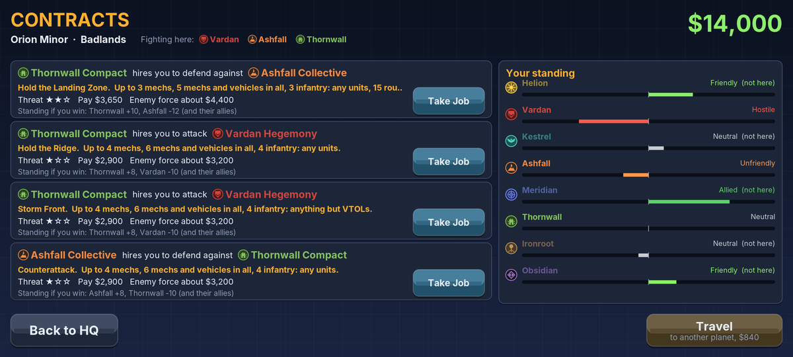 | 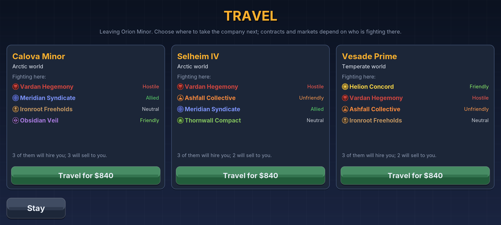 | 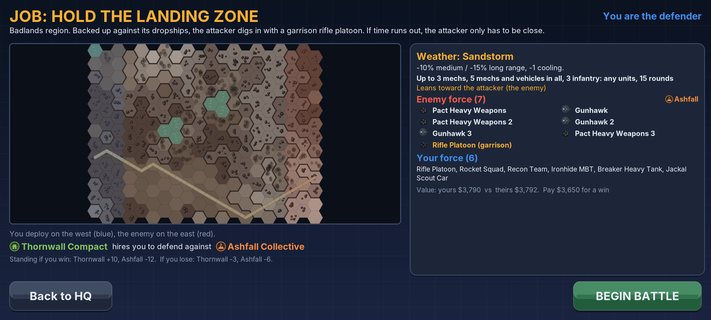 |

## Weapons and equipment

31 weapons in 3 classes. Light weapons mount on anything; medium need a medium-or-heavier mount; heavy only fit tracked tanks, heavy mechs and assault mechs.

- **Energy:** Light Laser, Light Burst Laser, Laser, Burst Laser, Heavy Laser, Plasma Caster (heats the target), Ion Lance (scrambles targeting)
- **Ballistic:** Chaingun, Light Cannon, Battle Cannon, Flak Repeater (anti-air), Siege Cannon, Rail Driver (armor-piercing)
- **Missile:** Light Rocket Pod, Rocket Pod, Heavy Rocket Pod, Light / standard / Heavy Volley Missiles (long range), Seeker Rockets (lock-on)
- **Artillery** (indirect fire on anything a friendly unit can see, with splash; most accurate at long range, very inaccurate up close): Field Mortar, Howitzer, Siege Howitzer
- **Melee** (mechs only): Vibro Blade, Arc Sword, Battle Axe, Great Axe, Thunder Hammer (staggers)
- **Infantry:** Assault Rifles, Satchel Charges, AT Missile Team

Equipment: Targeting Computer, ECM Suite, Sensor Suite, Turbo Booster, Coolant Pod, Smoke Launcher, Reflective Plating, Reactive Plating, Command Uplink, Field Repair Kit.

To customize a unit, select it at HQ and press **CUSTOMIZE**: you swap weapons and equipment mount by mount, set armor, heat sinks and ammo bins, all within the unit's weight capacity. Removed parts go to your spares and can be reinstalled free. Salvage from won battles adds to the spares.

| | | |
|---|---|---|
| 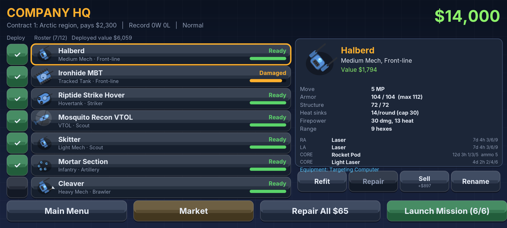 | 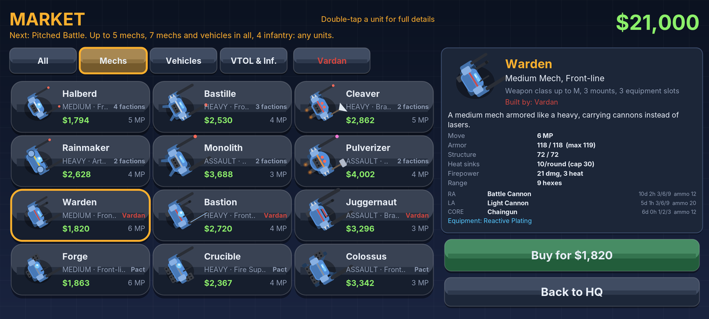 | 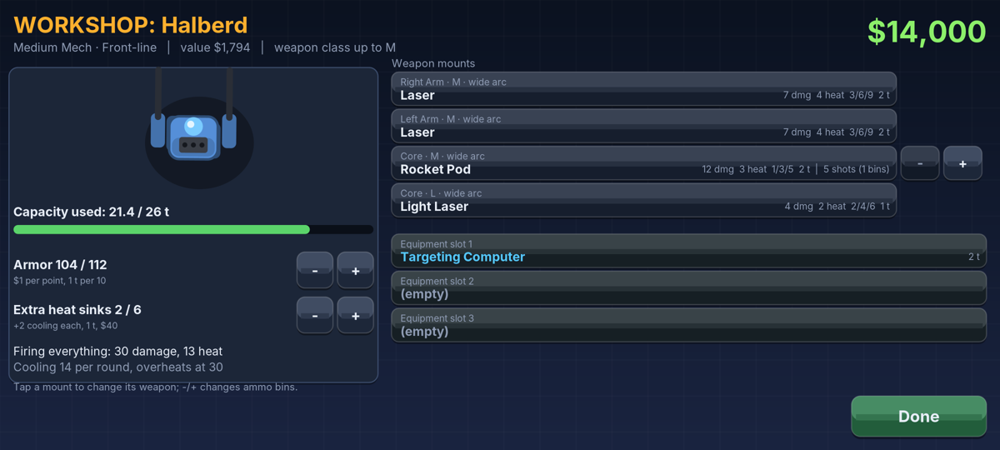 |
| 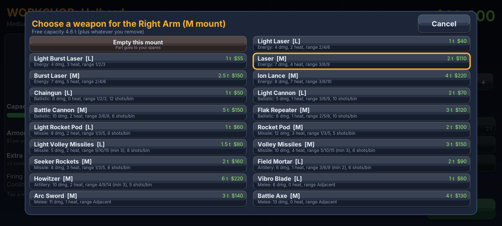 | 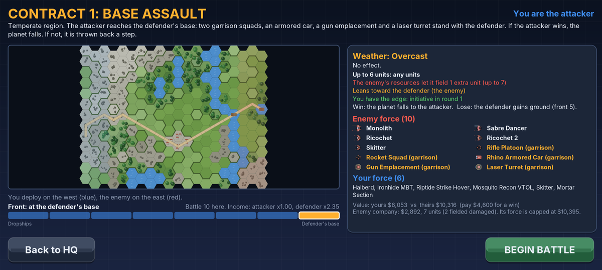 | 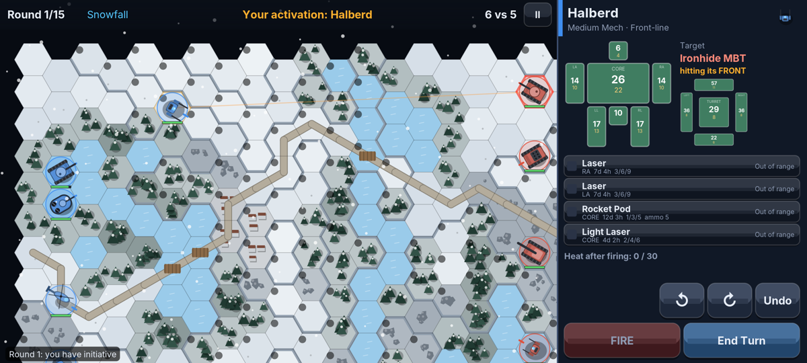 |
| 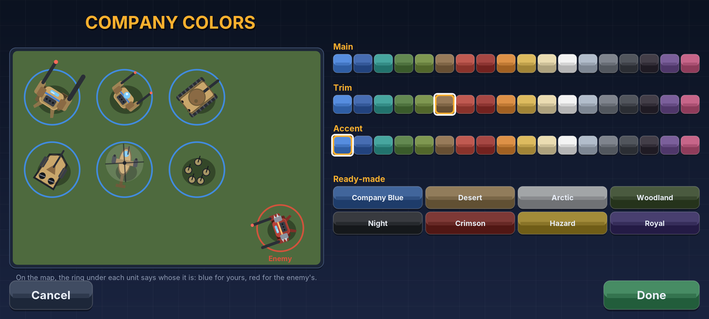 | 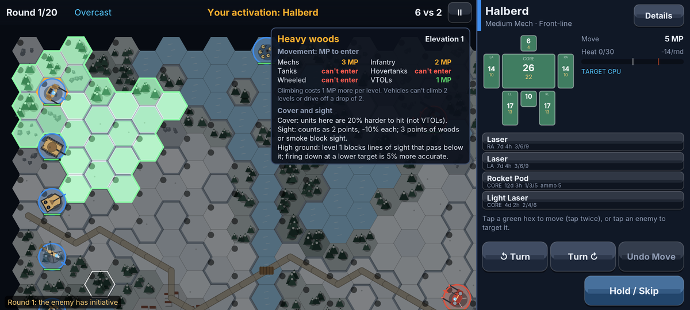 |  |
| 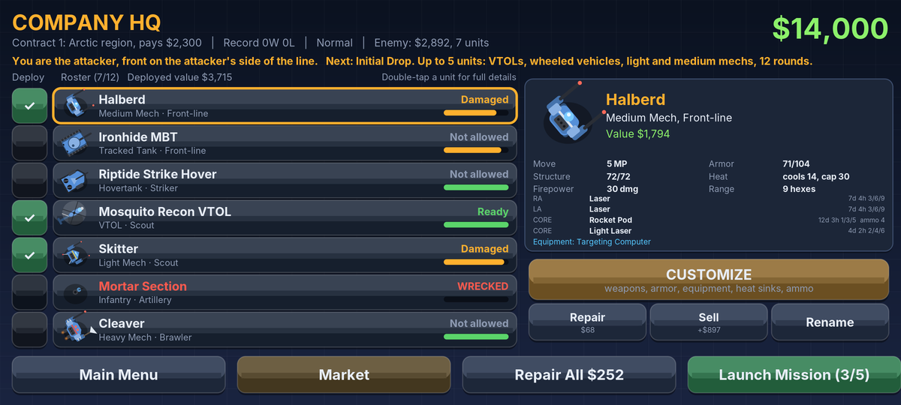 | 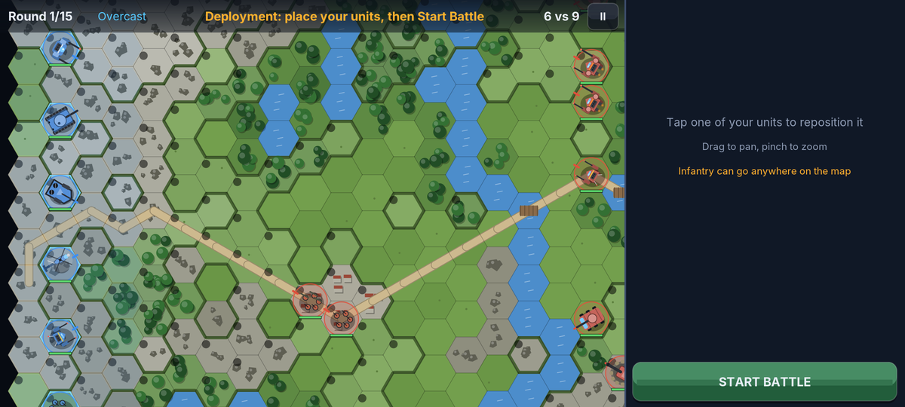 | 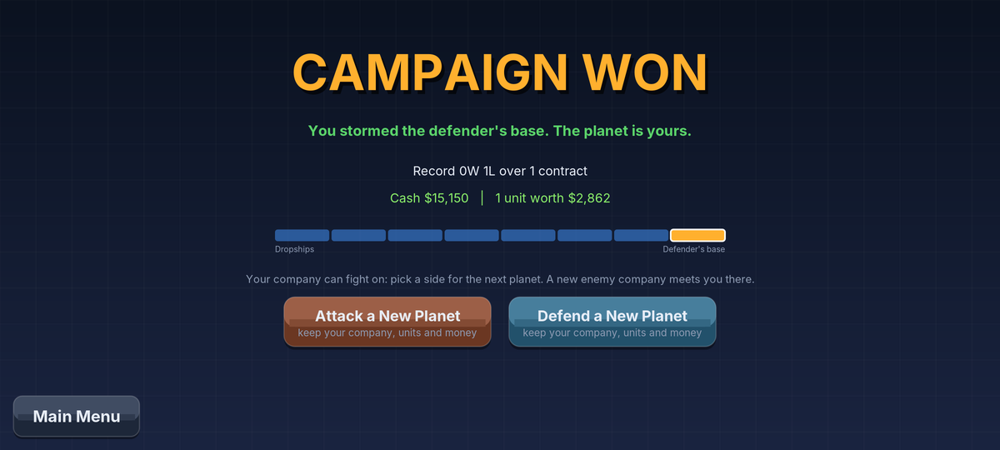 |

## Building

```bash
sudo apt-get install default-jdk aapt dalvik-exchange apksigner zipalign android-sdk-platform-23
```

```bash
./build.sh
```

That writes `release/Hexfront.apk`, signed with `keystore/hexfront.keystore` (keep it; updates must use the same key).

```bash
./build.sh test
```

That also validates every design, plays 20 computer-vs-computer battles headless (checking for crashes and stalls, and printing balance stats), plays a few campaign missions through the scenario system, saves and resumes battles, plays a few thousand random taps through every screen looking for crashes (`monkey`; `monkey-threads` runs the computer on its own thread as the phone does), and renders every screen to `build/shots/`.

```bash
./build.sh web
```

That builds the browser version: `release/Hexfront.html` and `release/web/`. It needs only a JDK, Maven (`brew install maven` on a Mac) and Python 3; Maven downloads TeaVM the first time.

## Code layout

- `src/core/`: the whole game in plain Java (rules, map generation, AI, screens, procedural art and sound), drawing through a small `Gfx` interface.
- `src/android/`: activity, render loop, Canvas renderer, SoundPool audio, saved data.
- `src/desktop/`: Java2D test harness (not in the APK).
- `src/web/` and `web/`: the browser version. [TeaVM](https://teavm.org) compiles `src/core` and the browser shell (canvas renderer, Web Audio, local storage, input) to JavaScript; `web/index.html` is the page. Build it with `./build.sh web` (needs a JDK, Maven and Python 3, not the Android tools). Online play uses the browser's WebSocket (`WebLink`).
- `server/`: the online relay. `relay.yaml` is an AWS CloudFormation template (API Gateway WebSocket, one Lambda, a DynamoDB table); `local_relay.py` runs the same relay code on your own computer for testing. Online play itself is `Online.java` in the core: both devices run the same battle and send each other their orders, with the same dice (`Rng`); a fingerprint of the battle (`Battle.stateHash`) after every batch of orders shows if they ever disagree, and then the host's copy is sent over. On Android, `SocketLink` is a small WebSocket client.
